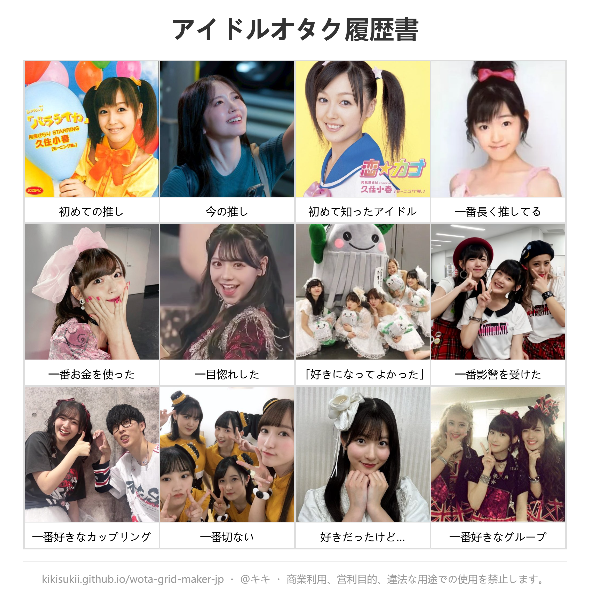

# Wota Grid Maker — My Idol Fan Journey

[中文](README.md) | [日本語](README.ja.md) | **English**

Make a 12-image grid of your idol fan journey: your first favorite, your current favorite, the group you love most, and more. I maintain the Chinese, Japanese and English versions together in this repository.

**Try it: [English](https://kikisukii.github.io/wota-grid-maker-en/) · [中文](https://kikisukii.github.io/wota-grid-maker/) · [日本語](https://kikisukii.github.io/wota-grid-maker-jp/)**

## Features

- Choose an image for each cell and crop it to a square.
- Reuse your last cropped image in another cell.
- Save cropped images in your browser and restore them when you return.
- Download the finished grid as a PNG.
- Clear saved images after confirming the reset.

## Make your grid

1. Open the English version and click a cell.
2. Choose an image, then adjust its position and zoom.
3. Click **Use this crop**.
4. Fill more cells, or select **Reuse last cropped image** to use the same image again.
5. Click **Download my grid** to save your PNG.

Use the language links above the grid to switch versions. These links stay outside the exported image.

## Example

A finished grid made with the Japanese version:

## Your images and saved progress

Images are read, cropped and exported in your browser. Cropped images are compressed to JPEG and stored in local storage on your current device and browser. All three language versions share the same saved grid: changing or clearing it in one version also affects the others when you open them.

Download a PNG to keep your finished work. Clearing browser data, private browsing and storage limits can affect saved progress. The app does not upload your images to a server; the page loads external CDN libraries and Google Analytics.

## Development and publishing

The site uses HTML, CSS and JavaScript, with Cropper.js 1.5.12 for cropping and html2canvas 1.4.1 for PNG export.

- `wota-grid-maker/`: Chinese page and styles.
- `wota-grid-maker-jp/`: Japanese page and styles.
- `wota-grid-maker-en/`: English page and styles.
- `shared/`: shared behavior, translated messages and language navigation styles.
- `README.md`, `README.ja.md`, `README.en.md`: Chinese, Japanese and English guides.

Serve the repository root with a static HTTP server and open `/wota-grid-maker-en/` to preview the English version. An internet connection is needed to load the external libraries.

I maintain the source here. The [publishing repository](https://github.com/kikisukii/kikisukii.github.io) reads this repository's `main` branch and publishes all three pages through GitHub Pages. Its workflow checks for updates about every 30 minutes and also supports manual publishing. The original Chinese and Japanese URLs stay the same.

## Use and credits

This is a personal project for fans to create and share grids for non-commercial use. Respect copyright, image rights and privacy when choosing images. You are responsible for the content you create and share. Illegal content is prohibited.

The template was inspired by idol fan grids shared online. Thanks to the original template creators!

- Website: Kiki. Sharing the love for Hello! Project and Airi Suzuki!
- Original coding assistance: Google Gemini.
- Hosting: GitHub Pages.
