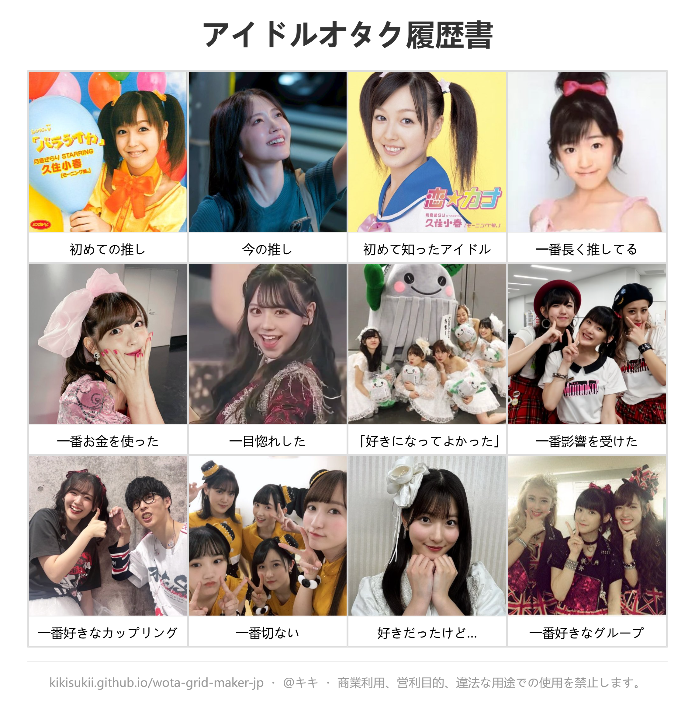

# Wota Grid Maker — アイドルオタク履歴書

[中文](README.md) | **日本語**

好きなアイドルの画像を12マスに並べて、自分だけの「アイドルオタク履歴書」を作れるブラウザツールです。中国語版と日本語版を、このリポジトリでまとめて管理しています。

**使ってみる：[日本語版](https://kikisukii.github.io/wota-grid-maker-jp/) · [中文版](https://kikisukii.github.io/wota-grid-maker/)**

## 主な機能

- **画像の選択とトリミング**：マスをクリックして画像を選び、正方形にトリミングできます。
- **PNG画像の書き出し**：完成した履歴書を画像としてダウンロードできます。
- **ブラウザ内の保存**：トリミングした画像をJPEGに圧縮し、ブラウザのローカルストレージに保存します。
- **画像の再利用**：「前回の画像を使用」で、直前にトリミングした画像を別のマスにも配置できます。
- **全リセット**：確認ダイアログで承認すると、保存した画像をまとめて削除できます。

## 使い方

1. [日本語版](https://kikisukii.github.io/wota-grid-maker-jp/)を開き、画像を入れたいマスをクリックします。
2. 画像ファイルを選択し、プレビュー上で位置や拡大率を調整します。
3. 「決定」をクリックします。
4. 別のマスにも画像を追加します。同じ画像なら「前回の画像を使用」を選べます。
5. 「履歴書画像を作成」をクリックしてPNG画像を保存します。

## 作成例

## 保存とプライバシー

画像の読み込み・トリミング・書き出しはブラウザ内で行い、アプリから画像をサーバーへアップロードする処理はありません。ページは外部CDNのライブラリとGoogle Analyticsを読み込みます。

画像の保存先は、現在の端末・ブラウザのローカルストレージです。ブラウザのデータ削除、プライベートブラウズや容量制限などにより、保存した画像が失われる場合があります。残しておきたい作品はPNGとしてダウンロードしてください。

従来どおり、中国語版と日本語版は同じ保存領域を使用します。一方で画像を変更・リセットすると、もう一方を次に開いたときにも反映されます。

## 開発と公開

HTML・CSS・JavaScriptで構成された静的サイトです。ビルドやAPIキーは不要です。画像のトリミングにCropper.js 1.5.12、PNGの生成にhtml2canvas 1.4.1を使用しています。

- `wota-grid-maker/`：中国語版のHTML・CSS。
- `wota-grid-maker-jp/`：日本語版のHTML・CSS。
- `shared/script.js`：共通処理と中国語・日本語のメッセージ。
- `assets/`：両バージョンの作成例。
- `README.md` / `README.ja.md`：中国語 / 日本語の説明。
- ルートの`index.html`：言語選択ページ。

ローカルでは、リポジトリのルートを静的HTTPサーバーで配信し、`/wota-grid-maker/`または`/wota-grid-maker-jp/`を開いてください。外部ライブラリを読み込むため、インターネット接続が必要です。

コードはこのリポジトリの`main`ブランチで管理します。[公開用リポジトリ](https://github.com/kikisukii/kikisukii.github.io)のGitHub Actionsがコードを取得してGitHub Pagesへ公開するため、従来の2つのURLをそのまま使えます。手動実行のほか、約30分ごとに更新を確認します。GitHubのスケジュール実行には遅延が生じる場合があり、長期間更新がないと停止することもあります。その場合は手動で再開できます。

両バージョンのコミット履歴を統合し、統合前の`main`・`assets`ブランチは`archive/*`タグでも参照できます。

## 利用について

本ツールは、ファン同士の交流と娯楽を目的とした非営利の個人プロジェクトです。商業・営利目的での利用は禁止します。使用する画像の著作権・肖像権・プライバシーを尊重し、違法なコンテンツの作成や共有には使用しないでください。アップロード・作成・共有する内容は、利用者自身の責任で扱ってください。

## 謝辞

- テンプレートのアイデアは、SNSで流行した同様のテンプレートを参考にしています。素敵なアイデアをありがとうございます。
- 制作：キキ / [Kichannahcik](https://space.bilibili.com/1819981/video)。ハロプロと鈴木愛理の魅力が、もっと多くの人に伝わりますように！
- 初期コードの制作協力：Google Gemini。
- ホスティング：GitHub Pages。
