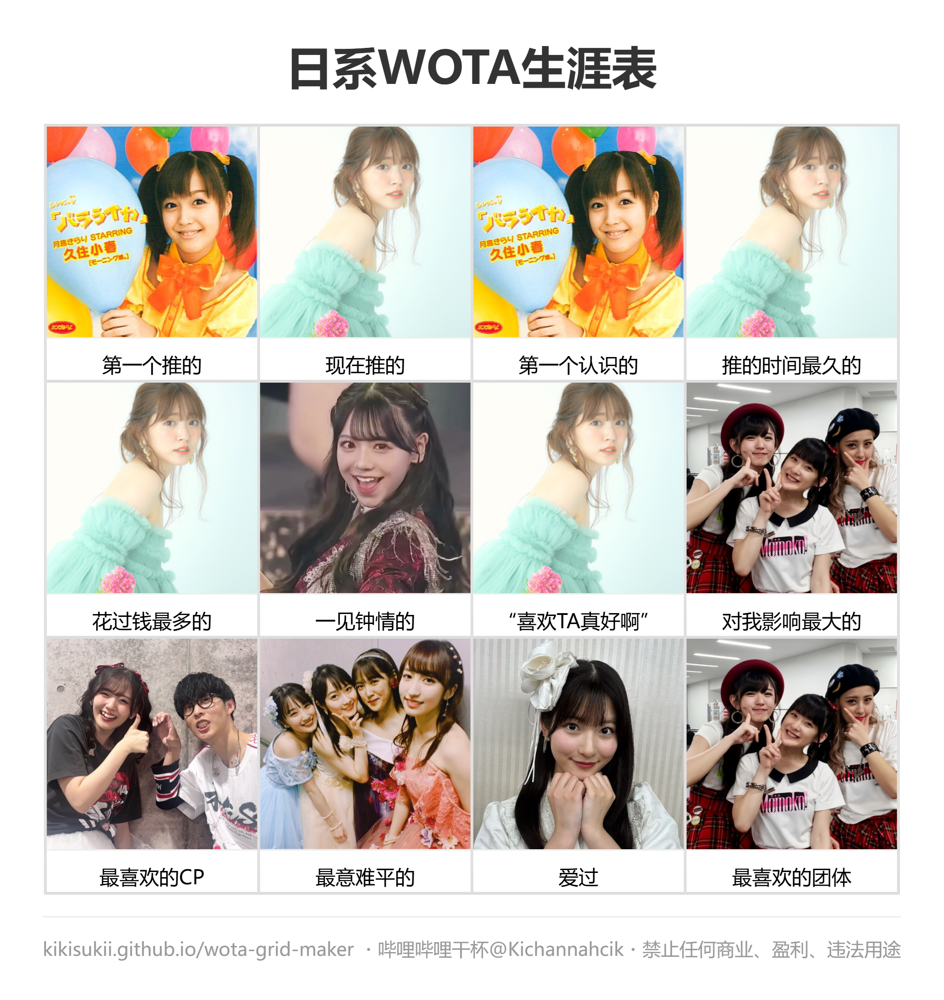

# Wota Grid Maker — 日系WOTA生涯表

**中文** | [日本語](README.ja.md)

把喜欢的偶像图片放进12个格子，制作属于自己的「日系WOTA生涯表」。中文版和日文版在这个仓库中统一维护。

**在线使用：[中文版](https://kikisukii.github.io/wota-grid-maker/) · [日本語版](https://kikisukii.github.io/wota-grid-maker-jp/)**

## 主要功能

- **图片选择与裁剪**：点击格子，选择图片并裁剪成正方形。
- **PNG图片导出**：把完成的生涯表下载为图片，方便保存和分享。
- **浏览器本地记忆**：裁剪后的图片会压缩为JPEG，保存在浏览器的本地存储中。
- **图片复用**：使用「使用上次剪裁的图片」，将刚裁好的图片填入其他格子。
- **一键清空**：确认后清空所有已保存的图片，重新开始制作。

## 使用方法

1. 打开[中文版](https://kikisukii.github.io/wota-grid-maker/)，点击想填入图片的格子。
2. 选择图片，在预览中调整位置和缩放。
3. 点击「确认裁剪」。
4. 继续填充其他格子；重复使用同一张图片时，可以点击「使用上次剪裁的图片」。
5. 点击「生成日系WOTA生涯表」，下载PNG图片。

## 制作示例

## 保存与隐私

图片读取、裁剪和导出均在浏览器中完成，应用没有将图片上传到服务器的处理逻辑。页面会加载外部CDN依赖和Google Analytics。

图片保存在当前设备、当前浏览器的本地存储中。清除浏览器数据、使用隐私模式或达到存储容量限制，都可能导致图片无法保留。需要长期保存的作品，请导出为PNG。

延续原有行为，中文版和日文版共用同一份本地存档。在其中一版修改或清空图片后，下次打开另一版时也会反映这些变化。

## 开发与部署

项目使用HTML、CSS和JavaScript，无需构建或API密钥。图片裁剪使用Cropper.js 1.5.12，PNG导出使用html2canvas 1.4.1。

- `wota-grid-maker/`：中文版HTML与CSS。
- `wota-grid-maker-jp/`：日文版HTML与CSS。
- `shared/script.js`：共用功能及中日文提示。
- `assets/`：两个版本的制作示例。
- `README.md` / `README.ja.md`：中文 / 日文说明。
- 根目录`index.html`：语言选择页。

本地开发时，用静态HTTP服务器提供仓库根目录，再打开`/wota-grid-maker/`或`/wota-grid-maker-jp/`。由于页面使用外部依赖，需要联网加载。

GitHub Pages从`main`分支的根目录发布。保留`kikisukii.github.io`仓库名和两个语言目录名，即可继续使用原来的两个网址。两版提交历史已合并；合并前的`main`和`assets`分支也保留为`archive/*`标签，便于查阅。

## 使用约定

本工具为非商业性个人项目，供同好娱乐与交流，禁止商业或盈利用途。请尊重所用图片的著作权、肖像权与隐私，不得用于制作、分享违法内容。使用者须对自行选择、制作和分享的内容负责。

## 致谢

- 模板创意源自网络流传的《日系女偶像WOTA生涯表》，感谢原作者。如需署名，请联系。
- 制作：[Kichannahcik](https://space.bilibili.com/1819981/video) / [キキ](https://x.com/Kikidaisuki_)。欢迎大家关注Hello! Project和铃木爱理！
- 初版代码协助：Google Gemini。
- 部署平台：GitHub Pages。
